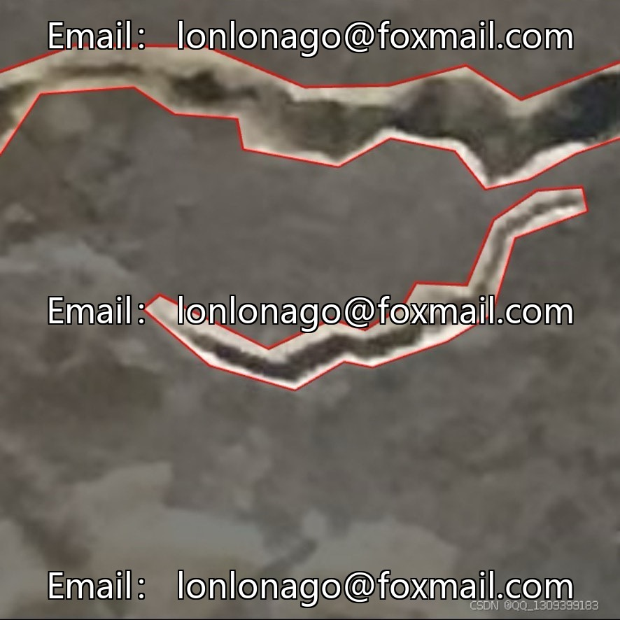
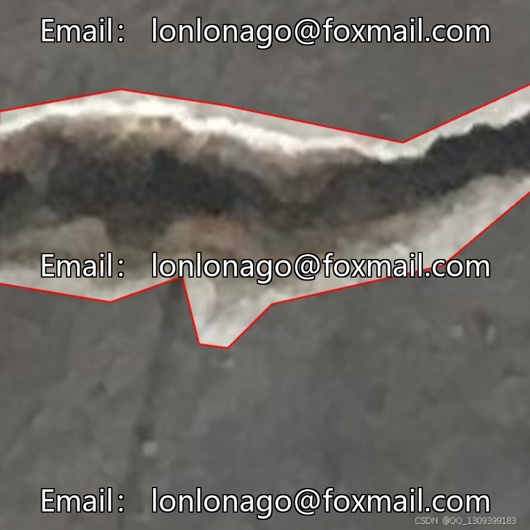
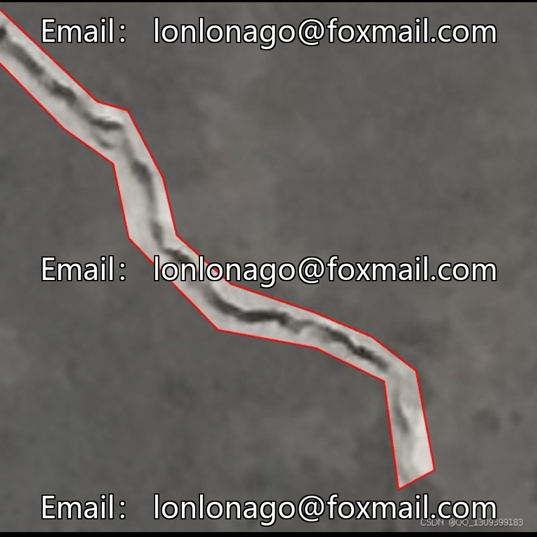
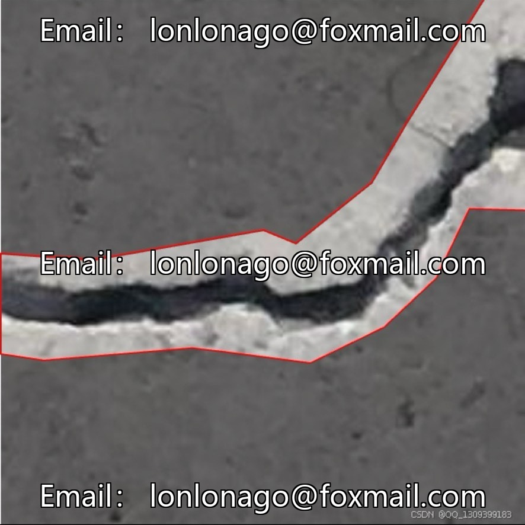

# Aerial photography bridge crack detection dataset, drone bridge health monitoring special, 100

## Body

Aerial photography bridge crack detection dataset, drone bridge health monitoring special, issue 10026

The dataset contains 3453 aerial imagery of drones, focusing on the detection of bridge cracks. The accompanying optimized model can be directly deployed for use. The annotation categories are only Crack (crack), supporting mainstream formats such as YOLO, COCO, VOC, Faster R-CNN, etc. There is no extraneous interference, making it highly targeted.

Scenes are rich, covering various bridge types such as beam bridges, arch bridges, and cable-stayed bridges, including different structural parts like the bridge deck, piers, and bearings. The environment is diverse (sunny, cloudy, backlight), with comprehensive samples. Cracks range from fine hairlines to structurally significant wide gaps, captured from multiple angles to enhance model adaptability. The original resolution should not be lower than 1920×1080, with close-ups reaching up to 4K. Before training, they are usually uniformly scaled down to 640×640 or 800×800.

Applicable to drone bridge automation inspection, structural disease warning, concrete crack identification algorithm research and development, can also be used as benchmark dataset in the field of bridge defect detection.

Virtual materials, once sold, are non-refundable.
Interested friends, click "I want" to proceed.

## Images

## Payment

Here is a pay link on Stripe ( https://buy.stripe.com/3cs8yP7sY87d0vu9AB ). Please contact me lonlonago@foxmail.com after funding $89, and I will send you a complete data files , thank you!

